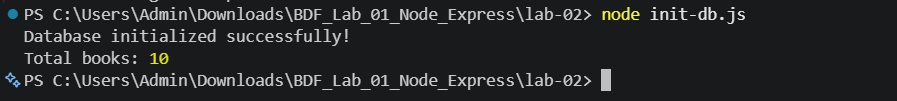
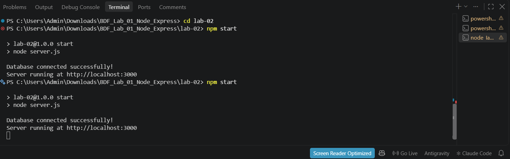
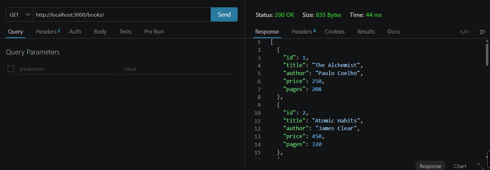
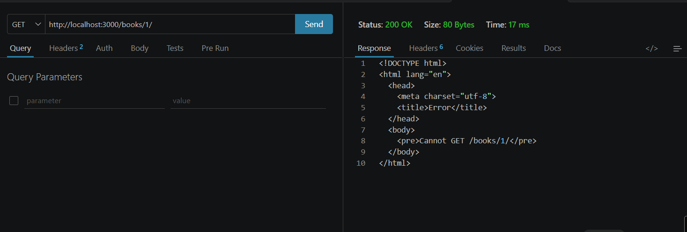
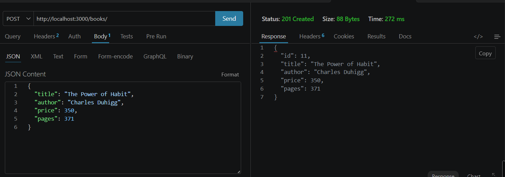
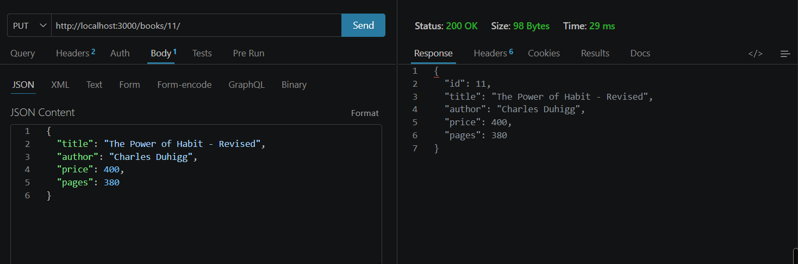
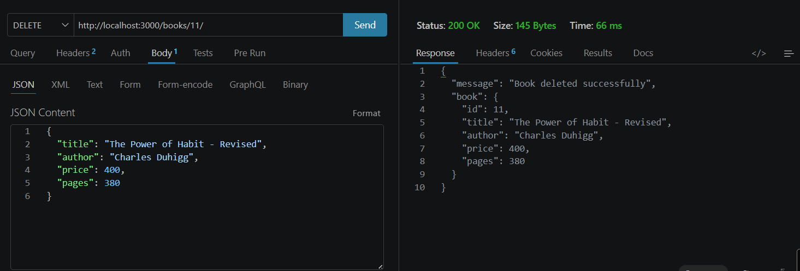
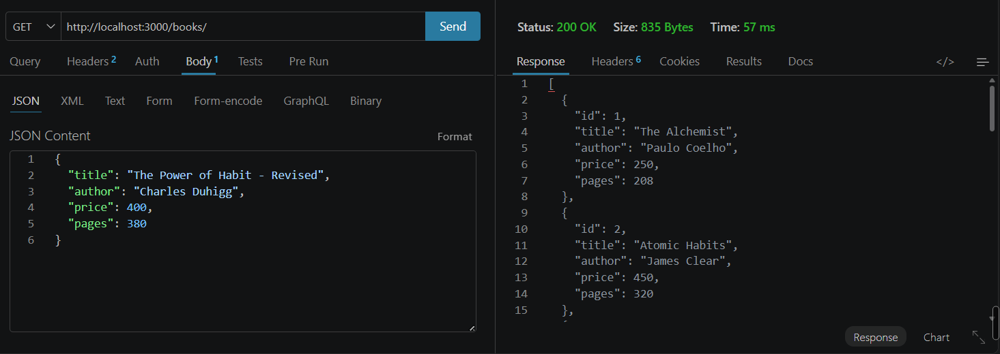

# Lab 2: SQLite Database and CRUD Routes

**Name:** S DHEERAJ KUMAR  
**Registration Number:** 252U1R9140  
**Section:** CSE(GAI)-2C  
**Course:** Backend Development Fundamentals

## Live Link

**Status:**this project currently runs locally using Node.js, Express.js, and SQLite.

Local URL: `http://localhost:3000`
Live URL:https://bdf-labs-1-bedw.onrender.com
## Objective

To connect an Express.js server to an SQLite database and implement REST API endpoints for creating, reading, updating, and deleting book records.

## Technologies Used

- Node.js
- Express.js
- SQLite
- sqlite3
- sqlite
- Nodemon
- JavaScript

## Project Structure

```text
lab-02/
├── Screenshots/
├── books.db
├── init-db.js
├── package.json
├── package-lock.json
├── server.js
└── README.md
```

## Installation and Setup

### 1. Navigate to the project directory

```bash
cd lab-02
```

### 2. Install dependencies

```bash
npm install
```

### 3. Initialize the database

```bash
node init-db.js
```

This command initializes the SQLite database and creates the required book table with sample records.

### 4. Start the server

```bash
npm start
```

Alternatively, use Nodemon during development:

```bash
npm run dev
```

### 5. Open the application

Visit the following URL in your browser:

`http://localhost:3000`

The terminal should display:

```text
Database connected successfully!
Server running at http://localhost:3000
```

## API Endpoints

| HTTP Method | Endpoint | Description |
|---|---|---|
| GET | `/` | Displays the API status message. |
| GET | `/books/` | Retrieves all books from the database. |
| GET | `/books/:bookId` | Retrieves a specific book using its ID. |
| POST | `/books/` | Adds a new book to the database. |
| PUT | `/books/:bookId` | Updates an existing book using its ID. |
| DELETE | `/books/:bookId` | Deletes a book using its ID. |

## Sample API Requests

### 1. Retrieve all books

**Method:** GET

**URL:** `http://localhost:3000/books/`

Returns all book records stored in the SQLite database.

### 2. Retrieve a book by ID

**Method:** GET

**URL:** `http://localhost:3000/books/1`

Returns the book whose ID is `1`, if it exists.

### 3. Add a new book

**Method:** POST

**URL:** `http://localhost:3000/books/`

**Request Body:**

```json
{
  "title": "The Power of Habit",
  "author": "Charles Duhigg",
  "price": 350,
  "pages": 371
}
```

### 4. Update a book

**Method:** PUT

**URL:** `http://localhost:3000/books/1`

**Request Body:**

```json
{
  "title": "The Power of Habit - Revised",
  "author": "Charles Duhigg",
  "price": 400,
  "pages": 380
}
```

Use the actual book ID returned by the API when testing.

### 5. Delete a book

**Method:** DELETE

**URL:** `http://localhost:3000/books/1`

Use the ID of the book you want to delete.

## Screenshots

The following screenshots demonstrate the execution and testing of the SQLite CRUD API.

### 1. Database Initialization



### 2. Server Running



### 3. Retrieve All Books



### 4. Retrieve a Book by ID



### 5. Add a Book



### 6. Update a Book



### 7. Delete a Book



### 8. Verify Deletion



## Database Details

The project uses an SQLite database named `books.db` and a table named `book`.

The table contains the following fields:

| Column | Description |
|---|---|
| `id` | Unique identifier for each book. |
| `title` | Title of the book. |
| `author` | Author of the book. |
| `price` | Price of the book. |
| `pages` | Number of pages in the book. |

The database initialization script creates the table and inserts 10 sample book records when the table is empty.

## Error Handling and Security

- Parameterized SQL queries are used to handle user input safely.
- HTTP status codes are returned for successful operations and errors.
- A `404 Not Found` response is returned when a requested book does not exist.
- A `400 Bad Request` response is returned when required fields are missing during book creation.
- Database and server errors are handled using `try...catch` blocks.

## Problems Faced and Solutions

- **Database initialization:** Used an initialization script to create the database table and insert sample records.
- **Database connection:** Opened the SQLite database before starting the Express server.
- **CRUD operations:** Implemented separate routes for retrieving, inserting, updating, and deleting books.
- **Request handling:** Used `express.json()` to parse JSON request bodies.
- **SQL safety:** Used parameterized queries to avoid directly inserting user input into SQL statements.

## Conclusion

This lab demonstrates how to integrate SQLite with Node.js and Express.js to develop a REST API. The project implements all four CRUD operations, uses parameterized SQL queries, handles common errors, and returns appropriate HTTP status codes.

The completed application provides practical experience in database connectivity, REST API development, asynchronous programming, and backend application testing.
