# Lab 3: REST API, Query Parameters, Validation and Debugging

## Student Details

- **Name:** S Dheeraj Kumar
- **Registration Number:** 252U1R9140
- **Section:** CSE(GAI)-2C

## Objective

To develop a RESTful API using Node.js, Express.js and SQLite with search functionality, sorting, pagination, price filtering, input validation and appropriate HTTP status codes.

## Technologies Used

- Node.js
- Express.js
- SQLite
- JavaScript
- Thunder Client
- Visual Studio Code

## Project Structure

```text
lab-03/
├── screenshots/
├── books.db
├── init-db.js
├── server.js
├── package.json
├── package-lock.json
└── README.md
```

## Installation and Setup

1. Navigate to the lab-03 directory.

```bash
cd lab-03
```

2. Install dependencies.

```bash
npm install
```

3. Initialize the database.

```bash
node init-db.js
```

4. Start the server.

```bash
node server.js
```

The server runs at:

`http://localhost:3000`

## API Endpoints

| Method | Endpoint | Description |
|---|---|---|
| GET | / | Welcome message |
| GET | /books | Retrieve all books |
| GET | /books/:id | Retrieve a book by ID |
| POST | /books | Add a new book |
| PUT | /books/:id | Update a book |
| DELETE | /books/:id | Delete a book |

## Query Parameters

| Parameter | Description |
|---|---|
| search_q | Search books by partial title |
| order_by | Sort by a selected column |
| order | ASC or DESC |
| limit | Maximum number of records |
| offset | Number of records to skip |
| min_price | Minimum book price |
| max_price | Maximum book price |

### Example Requests

Search:

`GET /books?search_q=Atomic`

Sorting:

`GET /books?order_by=price&order=DESC`

Pagination:

`GET /books?limit=5&offset=0`

Price filtering:

`GET /books?min_price=200&max_price=500`

## Validation and HTTP Status Codes

| Status Code | Description |
|---|---|
| 200 | Successful request |
| 201 | Book created successfully |
| 400 | Invalid input or parameters |
| 404 | Book not found |
| 500 | Internal server error |

## Screenshots

### 1. Retrieve All Books

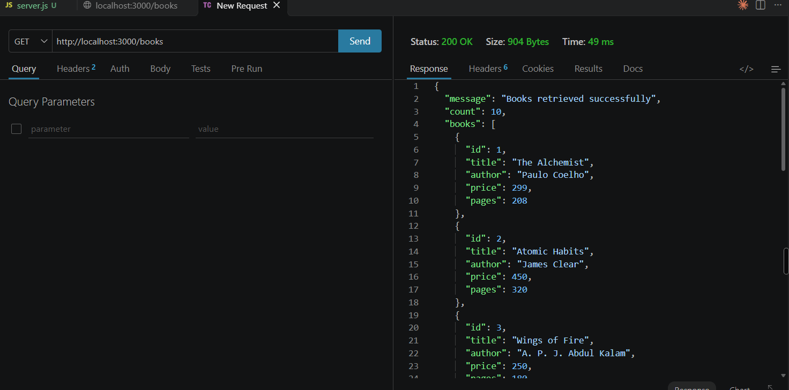

### 2. Search Books

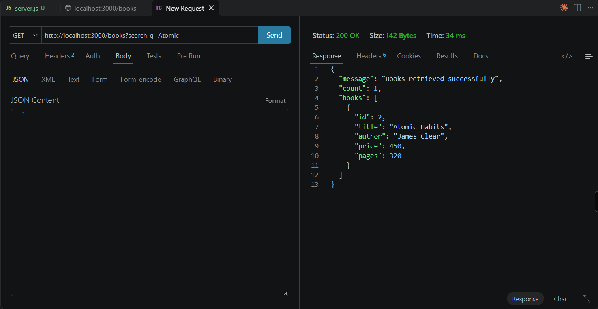

### 3. Sort Books

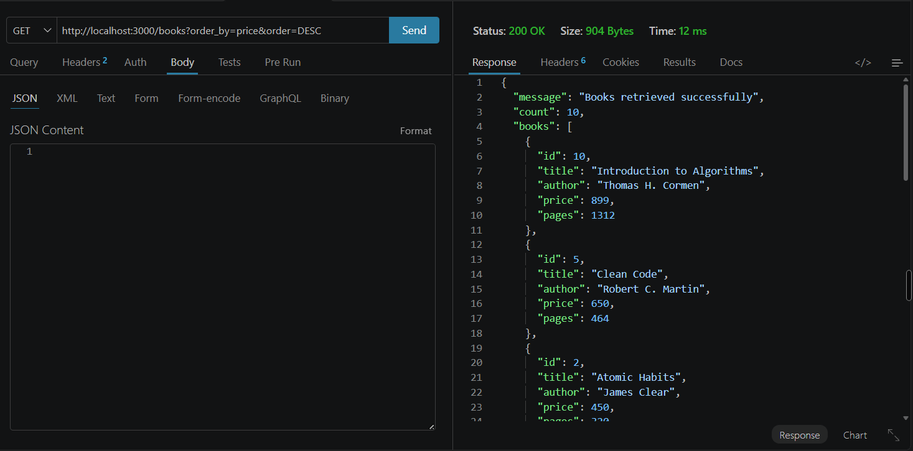

### 4. Pagination - First Page

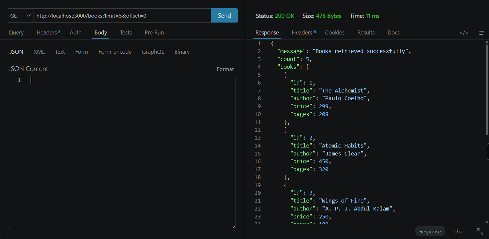

### 5. Pagination - Second Page

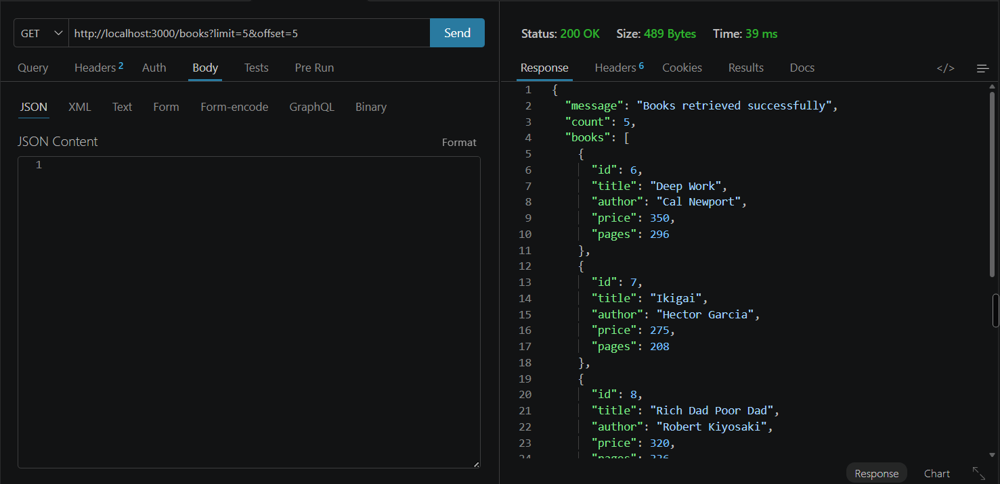

### 6. Price Range Filter

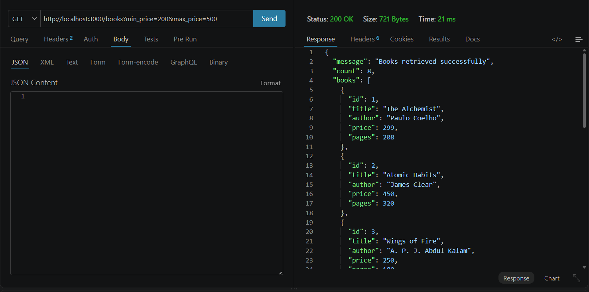

### 7. Validation - Missing Title

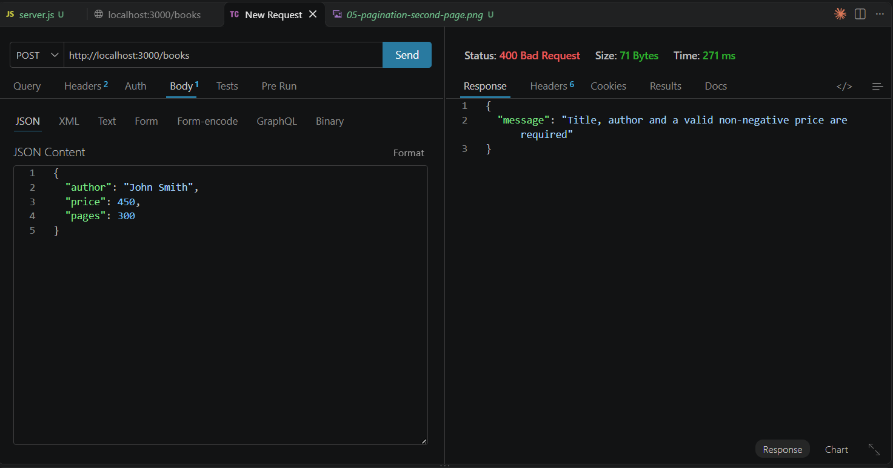

### 8. Validation - Invalid Price

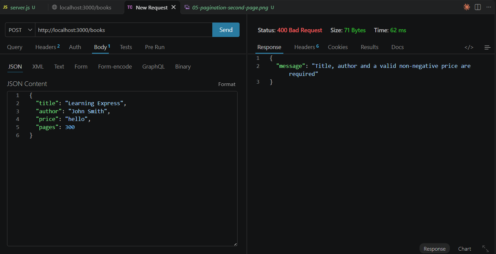

### 9. Create Book

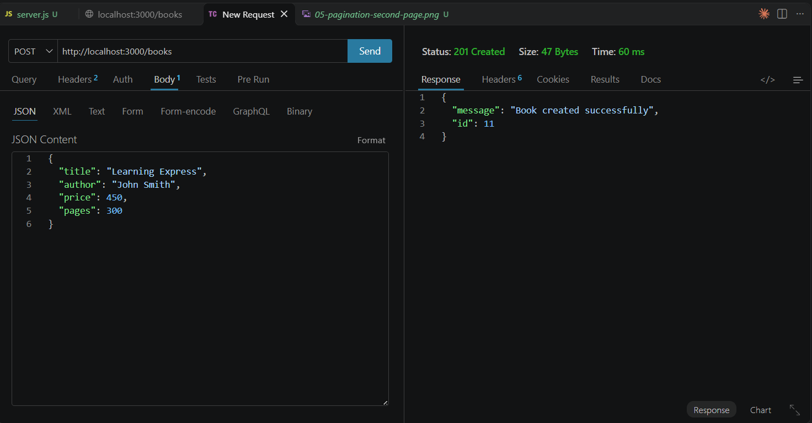

### 10. Update Book

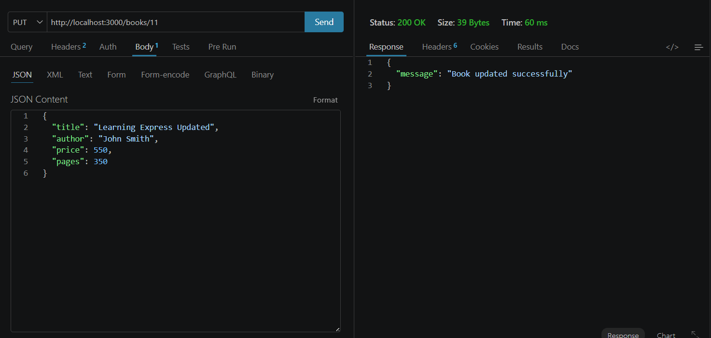

### 11. Delete Book

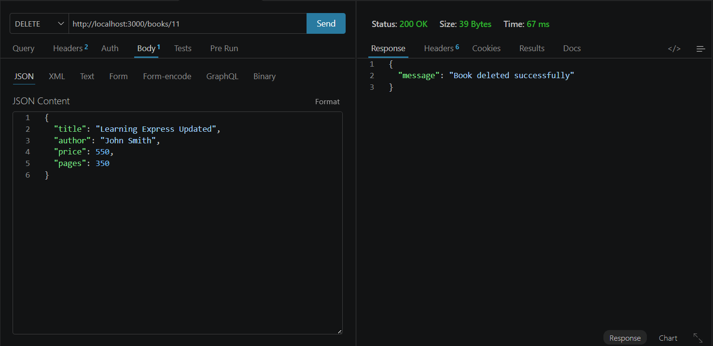

### 12. Book Not Found

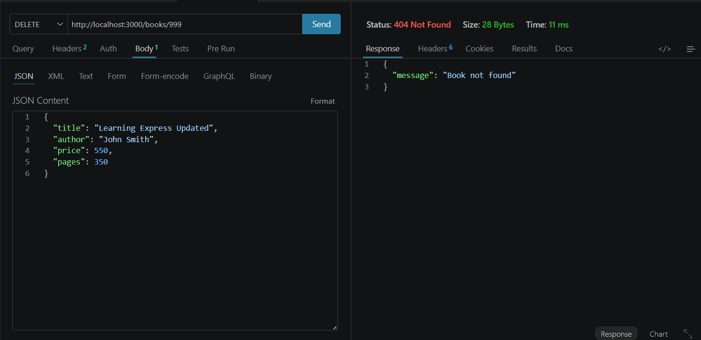

### 13. Invalid Sorting

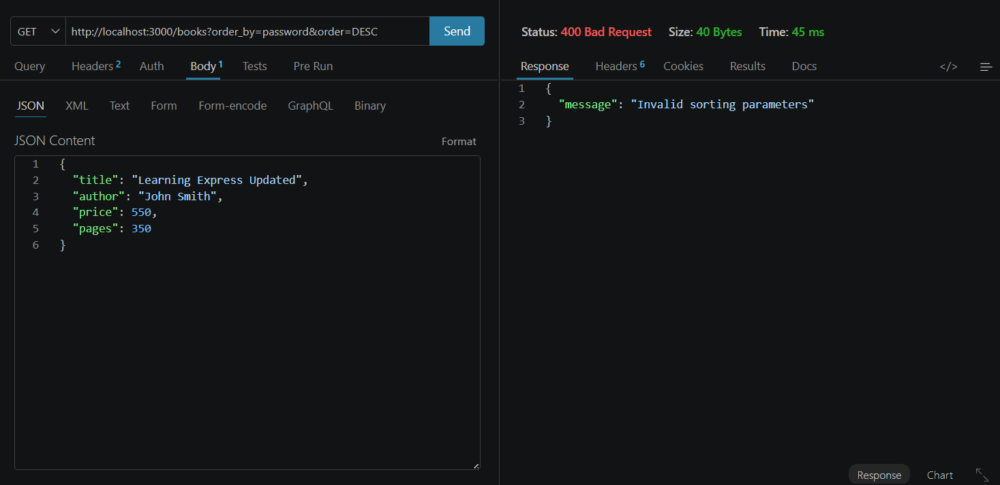

### 14. Invalid Pagination

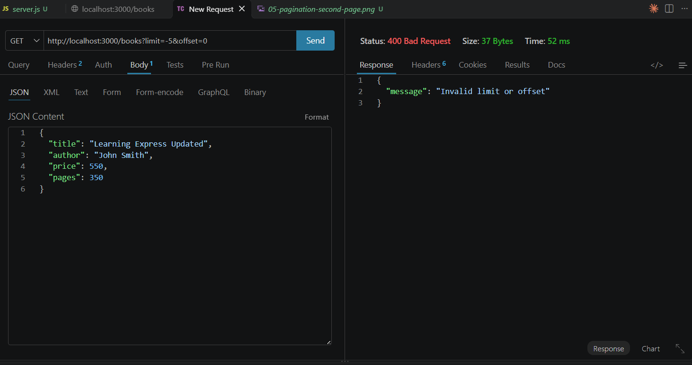


## Live Deployment

**Render URL:** https://bdf-labs-3-zs6i.onrender.com/

**Books API:** https://bdf-labs-3-zs6i.onrender.com/books

## Conclusion

In this lab, I developed a RESTful API using Node.js, Express.js and SQLite. I implemented CRUD operations, search, sorting, pagination and price range filtering. I also practised input validation, handling errors and returning appropriate HTTP status codes.

The lab helped me understand REST API development and debugging in a practical environment.
